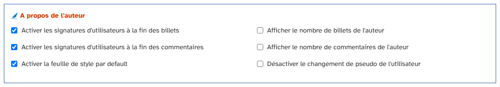
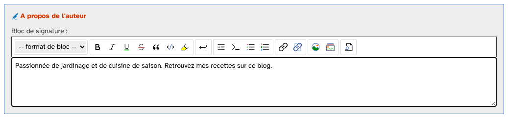
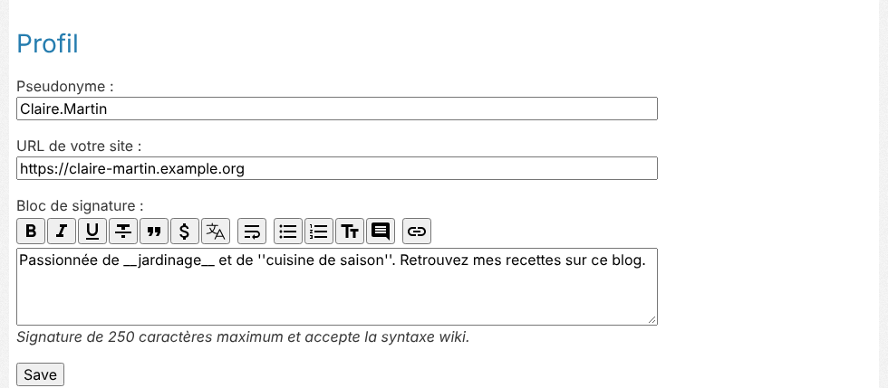
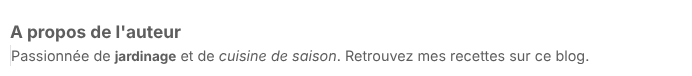
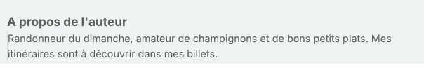
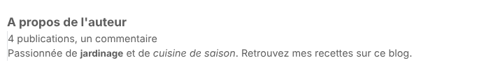
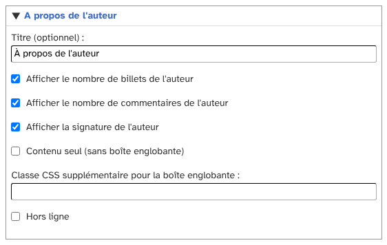
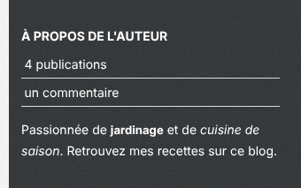

# AboutTheAuthor2 : guide d'utilisation

AboutTheAuthor2 ajoute un bloc « A propos de l'auteur » à la fin des billets et des commentaires. Ce bloc affiche la signature de l'auteur, et, si vous le souhaitez, son nombre de billets et de commentaires.

## Sommaire

* [Avant de commencer](#avant-de-commencer)
* [Régler le plugin pour le blog](#régler-le-plugin-pour-le-blog)
* [Écrire sa signature](#écrire-sa-signature)
* [Modifier sa signature depuis le blog public](#modifier-sa-signature-depuis-le-blog-public)
* [Ce que voient les visiteurs](#ce-que-voient-les-visiteurs)
* [Le widget](#le-widget)
* [À savoir](#à-savoir)

## Avant de commencer

AboutTheAuthor2 a besoin du plugin **commentsWikibar** (la Wikibarre). Sans lui, aucune signature n'est affichée ni modifiable.

Installez-le, puis allez dans le menu *Plugins*, cliquez sur *Wikibarre* et cochez *Activer la Wikibarre*.

Le plugin **FrontendSession** est facultatif. Il permet aux auteurs de modifier leur signature depuis le blog public.

## Régler le plugin pour le blog

Allez dans *Paramètres du blog*, ouvrez la section *Paramètres des plugins pour ce blog*, puis le bloc *A propos de l'auteur*.

Les options :

* *Activer les signatures d'utilisateurs à la fin des billets*.
* *Activer les signatures d'utilisateurs à la fin des commentaires*.
* *Activer la feuille de style par default* : une mise en forme simple, utilisée seulement avec les thèmes du jeu de templates « dotty ».
* *Afficher le nombre de billets de l'auteur*.
* *Afficher le nombre de commentaires de l'auteur*.
* *Désactiver le changement de pseudo de l'utilisateur* : empêche les auteurs de changer leur pseudo depuis le blog public.

Enregistrez avec le bouton en bas de la page.

## Écrire sa signature

Chaque utilisateur écrit sa propre signature.

Cliquez sur *Préférences* en haut à droite, puis sur l'onglet *Mes options*. Dans le bloc *A propos de l'auteur*, écrivez votre texte dans *Bloc de signature*.

La barre d'outils vous aide à mettre en forme le texte. Enregistrez avec le bouton en bas de la page.

Un super administrateur peut aussi écrire la signature d'un autre utilisateur, depuis la page de modification de cet utilisateur.

## Modifier sa signature depuis le blog public

Si FrontendSession est activé, un auteur connecté sur le blog public peut modifier son profil. Il voit, dans le bloc *Profil* de la page de son compte :

* *Pseudonyme* : trois caractères minimum, avec des lettres, des chiffres, des points, des tirets ou des tirets bas. Si le pseudo n'est pas valide, l'ancien est conservé ;
* *URL de votre site* ;
* *Bloc de signature* : 250 caractères au maximum.

Le pseudonyme n'est pas proposé si vous avez coché *Désactiver le changement de pseudo de l'utilisateur*.

## Ce que voient les visiteurs

Le bloc est affiché à la fin du billet, sur la page du billet :

Il est aussi affiché sous chaque commentaire écrit par un auteur du blog :

Le blog retrouve l'auteur d'un billet ou d'un commentaire par son adresse e-mail. Les commentaires des visiteurs qui ne sont pas des auteurs n'ont pas de signature.

Si vous avez coché les options de comptage, le bloc ajoute le nombre de billets et de commentaires de l'auteur :

Le bloc n'est pas affiché si l'auteur n'a pas de signature et que les nombres sont masqués.

## Le widget

Le plugin fournit aussi un widget. Il affiche le bloc de l'auteur du billet affiché, dans un volet de votre thème.

Allez dans la page *Widgets* et ajoutez *A propos de l'auteur* au volet de votre choix. Ses réglages :

* *Titre (optionnel)* ;
* *Afficher le nombre de billets de l'auteur* ;
* *Afficher le nombre de commentaires de l'auteur* ;
* *Afficher la signature de l'auteur* ;
* *Contenu seul (sans boîte englobante)*, *Classe CSS supplémentaire* et *Hors ligne*, comme pour les autres widgets.

Le widget n'apparaît que sur les pages qui affichent un billet, et seulement si l'auteur a une signature.

## À savoir

* La signature est mise en forme avec la syntaxe wiki, ou avec Markdown si votre blog utilise Markdown pour les commentaires. Pour profiter de toute la syntaxe wiki, cochez *Autoriser la syntaxe wiki pour les commentaires* dans les paramètres du blog. Sinon, seule la syntaxe wiki simple est comprise.
* Les nombres de billets et de commentaires sont ceux du blog courant, comptés par adresse e-mail.
* Les rétroliens (trackbacks) n'affichent jamais de signature.
